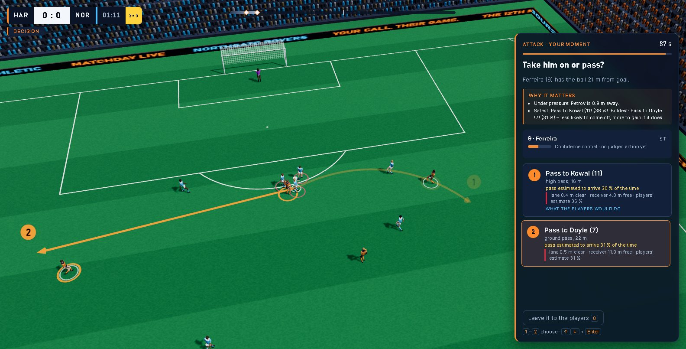
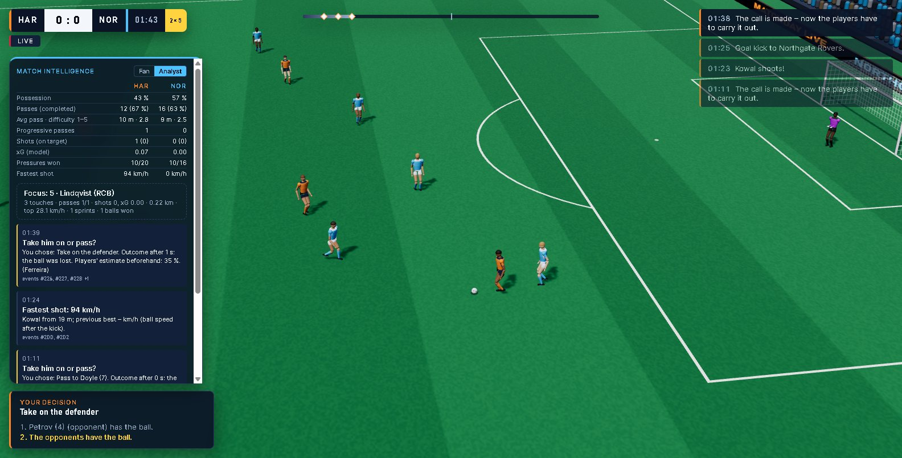

# THE 12TH MAN

**An agent-based football match you coach at the moments that matter, with match intelligence that explains every one of them.**

Twenty-two autonomous players play a full 11-v-11 match on their own. Every event comes from a real physics simulation with an independent referee, and everything is synthetic. A decision orchestrator stops the match only when there is a real choice, for example a risky build-up pass, a corner routine, a defensive wall or a half-time team talk. You decide, and the players try to carry it out. Feet, ball and opponents decide whether it works.

Next to the match runs a match intelligence pipeline. It turns the synthetic event stream into statistics, patterns and explanations:

- **Fan mode** gives you the story.
- **Analyst mode** gives you the numbers, and every statement cites the events it rests on.
- Both modes work in **English and German**.

> Built for the Microsoft × Premier League hackathon *"Inside the Game"*. All teams, players and data are fictional. No real match data, footage, logos or likenesses are used.

| | |
| --- | --- |
|  |  |

## Why

Football coverage usually reports *what* happened. THE 12TH MAN shows *why* a moment matters and *what came of a decision*. It makes the same moment readable for a casual fan and for a data-minded analyst, on screen next to the play.

## How it works

### The match: autonomous agents on real physics

- **22 player agents.** Each one has his own perception (field of view, reaction latency), abilities and character: risk appetite, team play, discipline and confidence. His form comes from his real actions in this match, and his trust in team-mates grows with passes that arrived. Optionally, players remember earlier matches in the browser.
- **Physics.** Rapier 3D drives ball, body and boot contacts at 240 Hz, with drag, the Magnus effect and rolling resistance. A pass or shot is a real swing of a boot.
- **Referee.** The IFAB Laws are applied: offside, fouls, cards, advantage, the back-pass rule, restarts, and Law 3 substitutions. The computer coach of the other team makes its own substitutions.
- **Orchestrator.** It looks at the frozen state before players commit. It offers only options that can actually be executed, with the players' own estimate of success. It never decides an outcome.

### Match intelligence: one pipeline, five stages

This follows the hackathon's *Ingest → Interpret → Explain → Render → Personalize* (`src/intel/`):

| Stage | Module | What it does |
| --- | --- | --- |
| Ingest | `board.ts` | Every `MatchEvent` in display order, together with the frame of its tick, plus sampled frames. |
| Interpret | `stats.ts` | <ul><li>Passes with distance, completion and a 1–5 difficulty rating from length, pressure and progression</li><li>Shots with speed and model xG</li><li>Possession and territory, possession changes, turnovers by zone</li><li>Pressure on the ball carrier and whether it won the ball</li><li>Distance, top speed and sprints per player</li></ul> |
| Explain | `patterns.ts`, `moment-brief.ts` | <ul><li>Insights with reasons: the story of each goal (origin, passes, assist), big chances and saves, which team is on top, control or chaos, a high press that works, fastest shot, what came of each user decision</li><li>Decision scenes get *why it matters*: who presses the actor and how fast, how open each passing lane is, how free the receiver is, safest against boldest option</li></ul> |
| Render | `narrator.ts`, `ui/intel-panel.ts` | Fan and analyst wordings, overlay panel, player name tag with sprint speed, automated match report. |
| Personalize | start screen, `I` key | Club, mode, focus player and language. |

Every insight keeps its numbers and the IDs of the events it was derived from. Nothing is invented: a test checks that every cited event exists and that goals, shots and possession changes match an independent statistics module. At full time, the complete intelligence can be downloaded as a versioned, timed JSON feed (`the12thman.intel/v1`) for overlays or recaps.

### Optional AI narration: Microsoft Foundry (prepared, not yet deployed)

`api/` contains an Azure Function that sends one insight's facts to a model deployed in Microsoft Foundry. It uses `@azure/ai-projects` with `DefaultAzureCredential`, so the managed identity needs no key. The function returns a reworded text:

- The browser only knows the function's URL.
- Requests are validated, size-limited and rate-limited.
- The answer is rejected if it contains a number that is not in the facts.

The core logic is unit-tested (`src/intel/foundry/`). **The Azure resources do not exist yet, so the AI narration is off and all texts are generated locally.** Status and setup: [`api/README.md`](api/README.md) and [PROJECT_REPORT.md §12](PROJECT_REPORT.md).

## Quick start

Requirements: Node.js 24 (tested with 24.20 / npm 11.19). Nothing global is needed.

```bash
npm install
npm run dev          # open the printed URL
```

1. Choose **your club**, **Fan** or **Analyst**, an optional **focus player** and **2 × 15 min**. A session takes about 7 minutes of your time; every second of the 30 match minutes is simulated.
2. Press **Kick-off**. The match plays itself; quiet phases are condensed and every tick is still computed.
3. When the orchestrator stops, read *why it matters*. Press **1–4** to choose, or **0** to leave it to the players.
4. Press **I** to switch between fan and analyst mode. At full time you get the match report and can download the intelligence feed.

URL parameters for testing:

| Parameter | Effect |
| --- | --- |
| `?lang=de` | German interface |
| `?mode=analyst` | Analyst mode |
| `?team=1` | Coach the away side |
| `?focus=9` | Focus player ID |
| `?seed=123` | Reproduce a match |
| `?half=5` | Length of each half in minutes |
| `?memory=0` | No player memory |

## Scripts

| Command | What it does |
| --- | --- |
| `npm run check` | Type check, all unit and integration tests, production build |
| `npm run test:browser` | Real headless Chrome/Edge run with screenshots (`CHECK_SESSION=1` plays a whole session like a user; `CHECK_PREVIEW=1` uses the production build) |
| `npm run intel -- --seed 7 --half 15` | Export one synthetic match: the complete event log and its match intelligence, as JSON |
| `npm run sim` / `npm run probe` | Full autonomous match / multi-seed statistics |
| `npm run lab` | Shot lab: keeper against shots from 8–25 m |

A sample synthetic dataset (one 2 × 15 match: event log and intelligence feed) is in [`submission/sample-data/`](submission/sample-data/).

## Architecture

```text
src/engine/        match engine: time, phases, restarts, events, snapshots (headless, deterministic per seed)
src/physics/       Rapier world: ball, bodies, boots, keeper hands, goals and nets
src/ai/            player agents: perception, option evaluation, execution, keeper, mind and memory, bench coach
src/rules/         referee (IFAB Laws)
src/orchestrator/  decision moments from the real state (open play, set pieces, coach)
src/intel/         match intelligence pipeline, moment explanations, Foundry narration client and core
src/sim/           simulation in a Web Worker, frame transfer, presentation pacing
src/render/        Three.js stadium, figures, broadcast and decision cameras, tactical overlays, name tags
src/ui/            start, HUD, decision panel, intelligence panel, consequence card, result (CSS next to TS)
api/               optional Azure Function for Foundry narration (not deployed)
```

The simulation is the single writer of the match state. Orchestrator, intelligence and UI only read events and frames, and the user's choices enter as player intents. Same seed and same decisions give the same match, which is tested.

**Stack:** TypeScript 7, Three.js 0.186, Rapier 3D 0.21 (WASM, SIMD), Vite 8, Vitest 5. No backend is needed to play.

## Deployment

The demo is a static site. [`.github/workflows/pages.yml`](.github/workflows/pages.yml) builds, tests and deploys it to GitHub Pages. It runs only when started by hand, so a merge publishes nothing. To publish:

1. In the repository settings, set Pages to *Source: GitHub Actions*.
2. Go to Actions, select **Deploy demo to GitHub Pages** and click **Run workflow**.

To switch on the AI narration later, deploy `api/` and set the repository variable `NARRATION_URL`.

## Project documentation

[PROJECT_REPORT.md](PROJECT_REPORT.md) is the source of truth: architecture, measurements, tests, decisions and known limitations, by phase. Submission material is in [`submission/`](submission/).
