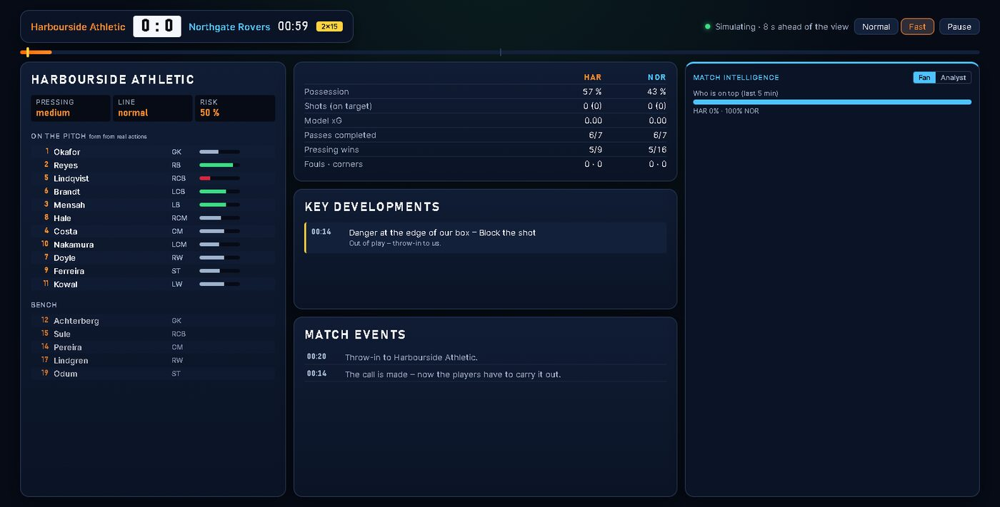
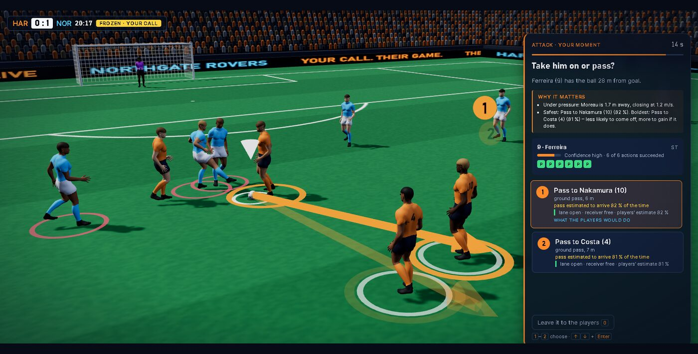
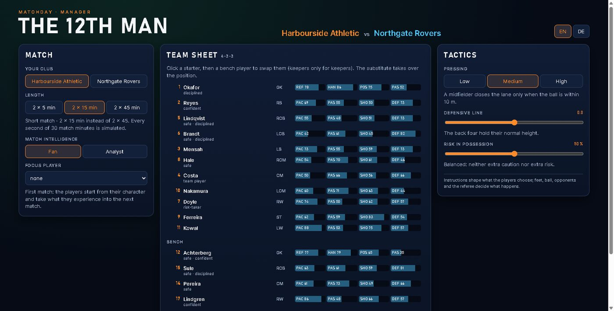
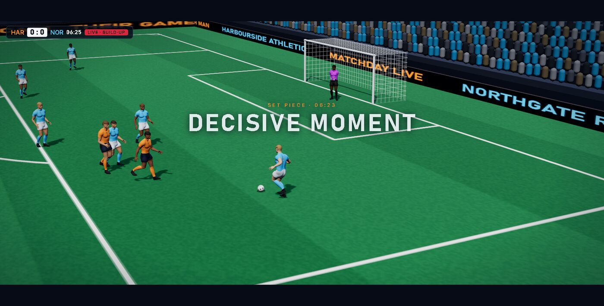

# THE 12TH MAN

**A football manager with autonomous AI players, where the decisive moments play out as cinematic, interactive 3D scenes – and match intelligence explains every one of them.**

You prepare the match like a manager: starting eleven and bench, pressing, defensive line and risk. Then twenty-two autonomous players play a full 11-v-11 match in the background, on a real physics simulation with an independent referee; everything is synthetic. You follow it in the manager view – score, minute, tactics, team form, timeline, statistics and match intelligence – without a permanent 3D picture. When the orchestrator finds a real choice in the match (a risky pass, a counter, a corner routine, a defensive wall, a penalty), the simulation stops, the last seconds of real play are shown in 3D, the scene freezes and you decide. The players try to carry it out; feet, ball and opponents decide whether it works. Then the match goes on from exactly there.

Next to the match runs a match intelligence pipeline. It turns the synthetic event stream into statistics, patterns and explanations:

- **Fan mode** gives you the story.
- **Analyst mode** gives you the numbers, and every statement cites the events it rests on.
- Both modes work in **English and German**.

> Built for the Microsoft × Premier League hackathon *"Inside the Game"*. All teams, players and data are fictional. No real match data, footage, logos or likenesses are used.

| | |
| --- | --- |
|  |  |
|  |  |

## Why

Football coverage usually reports *what* happened. THE 12TH MAN shows *why* a moment matters and *what came of a decision*. It makes the same moment readable for a casual fan and for a data-minded analyst, on screen next to the play.

## How it works

### The match: autonomous agents on real physics

- **22 player agents.** Each one has his own perception (field of view, reaction latency), abilities and character: risk appetite, team play, discipline and confidence. His form comes from his real actions in this match, and his trust in team-mates grows with passes that arrived. Optionally, players remember earlier matches in the browser.
- **Physics.** Rapier 3D drives ball, body and boot contacts at 240 Hz, with drag, the Magnus effect and rolling resistance. A pass or shot is a real swing of a boot.
- **Referee.** The IFAB Laws are applied: offside, fouls, cards, advantage, the back-pass rule, restarts, and Law 3 substitutions. The computer coach of the other team makes its own substitutions.
- **Orchestrator.** It looks at the frozen state before players commit. It offers only options that can actually be executed, with the players' own estimate of success. It never decides an outcome.

### Match intelligence: one pipeline, five stages

This follows the hackathon's *Ingest → Interpret → Explain → Render → Personalize* (`src/intel/`):

| Stage | Module | What it does |
| --- | --- | --- |
| Ingest | `board.ts` | Every `MatchEvent` in display order, together with the frame of its tick, plus sampled frames. |
| Interpret | `stats.ts` | <ul><li>Passes with distance, completion and a 1–5 difficulty rating from length, pressure and progression</li><li>Shots with speed and model xG</li><li>Possession and territory, possession changes, turnovers by zone</li><li>Pressure on the ball carrier and whether it won the ball</li><li>Distance, top speed and sprints per player</li></ul> |
| Explain | `patterns.ts`, `moment-brief.ts` | <ul><li>Insights with reasons: the story of each goal (origin, passes, assist), big chances and saves, which team is on top, control or chaos, a high press that works, fastest shot, what came of each user decision</li><li>Decision scenes get *why it matters*: who presses the actor and how fast, how open each passing lane is, how free the receiver is, safest against boldest option</li></ul> |
| Render | `narrator.ts`, `ui/intel-panel.ts` | Fan and analyst wordings in the manager view, explanation in each 3D scene, player name tag with sprint speed, half-time summary, automated match report. |
| Personalize | match preparation, `I` key | Club, team sheet, tactics, mode, focus player and language. |

Every insight keeps its numbers and the IDs of the events it was derived from. Nothing is invented: a test checks that every cited event exists and that goals, shots and possession changes match an independent statistics module. At full time, the complete intelligence can be downloaded as a versioned, timed JSON feed (`the12thman.intel/v1`) for overlays or recaps.

### Optional AI narration: Microsoft Foundry (prepared, not yet deployed)

`api/` contains an Azure Function that sends one insight's facts to a model deployed in Microsoft Foundry. It uses `@azure/ai-projects` with `DefaultAzureCredential`, so the managed identity needs no key. The function returns a reworded text:

- The browser only knows the function's URL.
- Requests are validated, size-limited and rate-limited.
- The answer is rejected if it contains a number that is not in the facts.

The core logic is unit-tested (`src/intel/foundry/`). **The Azure resources do not exist yet, so the AI narration is off and all texts are generated locally.** Status and setup: [`api/README.md`](api/README.md) and [PROJECT_REPORT.md §12](PROJECT_REPORT.md).

## Quick start

Requirements: Node.js 24 (tested with 24.20 / npm 11.19). Nothing global is needed.

```bash
npm install
npm run dev          # open the printed URL
```

1. **Match preparation:** choose your club. There is one match: **2 × 45 minutes**, each half shown in about 7 minutes (every second simulated; 3D scenes add their own time). Check the team sheet: click a starter, then a bench player, to swap them. Set pressing, defensive line and risk. Pick **Fan** or **Analyst** and an optional focus player.
2. Press **Kick-off**. The **manager view** follows the background simulation: score and minute, tactics, team with form, statistics, key developments, match events and match intelligence. **Pause** stops the simulation.
3. A **decisive scene** opens in 3D: the real build-up, a slow-motion freeze, the options on the pitch and *why it matters*. Press **1–4** (or click) to choose, **0** to leave it to the players. The consequence is played from newly computed frames, then you are back in the manager view.
4. **Substitutions** come as a dialog, the **team talk** in the half-time screen. **I** switches fan/analyst. At full time you get the match report, your decisions and the intelligence feed; **New match** starts again.

URL parameters for testing:

| Parameter | Effect |
| --- | --- |
| `?lang=de` | German interface |
| `?mode=analyst` | Analyst mode |
| `?team=1` | Coach the away side |
| `?focus=9` | Focus player ID |
| `?seed=123` | Reproduce a match |
| `?memory=0` | No player memory |

## Scripts

| Command | What it does |
| --- | --- |
| `npm run check` | Type check, all unit and integration tests, production build |
| `npm run test:browser` | Real headless Chrome/Edge run of a whole manager session with screenshots, invariants (every decision and event exactly once, no 3D in the manager view) and the match protocol (`CHECK_PREVIEW=1` production build, `CHECK_HALF=15`, `CHECK_RECORD=2` scene videos) |
| `node scripts/protocol.mjs --seeds 7` | Reference match protocol in Node with the same decisions; must equal the browser's `protocol.json` |
| `npm run intel -- --seed 7 --half 15` | Export one synthetic match: the complete event log and its match intelligence, as JSON |
| `npm run sim` / `npm run probe` | Full autonomous match / multi-seed statistics |
| `npm run lab` | Shot lab: keeper against shots from 8–25 m |

A sample synthetic dataset (one 2 × 15 match: event log and intelligence feed) is in [`submission/sample-data/`](submission/sample-data/).

## Architecture

```text
src/engine/        match engine: time, phases, restarts, events, snapshots (headless, deterministic per seed)
src/physics/       Rapier world: ball, bodies, boots, keeper hands, goals and nets
src/ai/            player agents: perception, option evaluation, execution, keeper, mind and memory, bench coach
src/rules/         referee (IFAB Laws)
src/orchestrator/  decision moments from the real state (open play, set pieces, coach)
src/intel/         match intelligence pipeline, moment explanations, Foundry narration client and core
src/sim/           simulation in a Web Worker, frame transfer, pause
src/session/       manager session: state machine (manager ⇄ scene), pacing, timeline (every event exactly once)
src/manager/       match preparation, manager view, half-time screen, substitution dialog (CSS next to TS)
src/render/        Three.js stadium, skinned footballer (Blender Human Base Meshes, CC0) posed from physics, scene cameras, tactical overlays
src/ui/            decision panel, intelligence panel, consequence card, result (CSS next to TS)
scripts/figure/    reproducible Blender build of the footballer model and its motion capture clips
api/               optional Azure Function for Foundry narration (not deployed)
```

The simulation is the single writer of the match state. Orchestrator, intelligence and UI only read events and frames, and the user's choices enter as player intents. Same seed and same decisions give the same match, which is tested.

**Motion:** the players move with motion capture from the CMU Graphics Lab Motion Capture Database (free for research and commercial use). The data used in this project was obtained from mocap.cs.cmu.edu. The database was created with funding from NSF EIA-0196217. Details: [scripts/figure/README.md](scripts/figure/README.md).

**Stack:** TypeScript 7, Three.js 0.186, Rapier 3D 0.21 (WASM, SIMD), Vite 8, Vitest 5. No backend is needed to play.

## Deployment

The demo is a static site. [`.github/workflows/pages.yml`](.github/workflows/pages.yml) builds, tests and deploys it to GitHub Pages. It runs only when started by hand, so a merge publishes nothing. To publish:

1. In the repository settings, set Pages to *Source: GitHub Actions*.
2. Go to Actions, select **Deploy demo to GitHub Pages** and click **Run workflow**.

To switch on the AI narration later, deploy `api/` and set the repository variable `NARRATION_URL`.

## Project documentation

[PROJECT_REPORT.md](PROJECT_REPORT.md) is the source of truth: architecture, measurements, tests, decisions and known limitations, by phase. Submission material is in [`submission/`](submission/).
